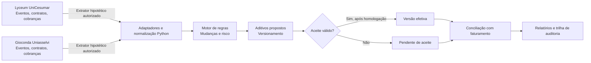

# FOURD × Vitru | POC 01 — Aditivos de contratos acadêmicos

**Tema 1 do workshop | UniCesumar / Lyceum e Uniasselvi / Gioconda**  
**Estado:** prova de conceito Python executável, dados 100% fictícios, sem acesso nem escrita em sistemas reais.

> **Hipótese de negócio:** adotar aditivos contratuais para alterações relevantes do aluno, com evidência por evento, preservação do contrato-base e conciliação com o financeiro.  
> **Não é implantação:** não pressupõe que Lyceum/Gioconda tenham as tabelas ou endpoints aqui descritos; isso deve ser confirmado pelo TI. Não gera instrumentos jurídicos válidos.

## 1. Problema que resolvemos

Uma mudança de polo, turma, curso, bolsa ou mensalidade pode ocorrer no sistema acadêmico e refletir em cobrança **sem evidência documental suficientemente rastreável** da nova condição do aluno. O auditor precisa reconstruir o passado por logs, planilhas, versões de contratos e telas não centralizadas.

A POC transforma **evento acadêmico → proposta de aditivo → aceite/evidência → versão contratual → conferência do valor faturado**, com exceções apropriadas. Cancelamentos e rescisões **não** são automaticamente convertidos em aditivo: vão para validação jurídica.

## 2. Execução em 1 minuto

Requisito: **Python 3.11+**. Somente biblioteca padrão; **nenhum `pip install` necessário**.

```powershell
# Windows PowerShell, a partir desta pasta
.\executar_demo.ps1

# ou etapas isoladas:
python -m poc_aditivos --entrada .\dados_ficticios --saida .\saida_demo
python -m unittest discover -s tests -v
```

Linux/macOS: `./executar_demo.sh`.

## 3. Arquitetura proposta — somente leitura nas origens



O motor não é um módulo substituto de contrato, assinatura ou cobrança; é uma **camada de controle e orquestração** a ser integrada ao fluxo aprovado pela Vitru.

## 4. Simulação incluída

| Caso | Origem | Evento | Resultado demonstrativo |
|---|---|---|---|
| EV-001 | Lyceum | Transferência de polo e alteração de valor mensal | Aditivo v2 com **aceite sintético**, cobrança conciliada |
| EV-002 | Lyceum | Alteração de bolsa e mensalidade | Aditivo v2 **pendente**; cobrança em risco por falta de lastro |
| EV-003 | Gioconda | Alteração de turma sem valor | Aditivo v2 com **aceite sintético** e versionamento da condição |
| EV-004 | Gioconda | Cancelamento de matrícula | **Exceção jurídica**; não emitir aditivo automaticamente |
| Sem evento | Lyceum | Contrato inalterado | Cobrança confrontada com o contrato-base |

## 5. Arquivos gerados em `saida_demo/`

| Artefato | Uso |
|---|---|
| `aditivos.csv` | Propostas, versão-base, versão proposta, diferenças, status e referência da evidência |
| `minutas/ADT-*.md` | Modelo de minuta demonstrativa, **não assinável** |
| `estado_contratual_simulado.csv` | Fotografia do contrato vigente apenas na simulação |
| `conciliacao_financeira.csv` | Valores da cobrança vs. condição simulada documentada |
| `excecoes.csv` | Cancelamento, evento órfão ou conflito de versões |
| `auditoria_hash_chain.jsonl` | Log encadeado por SHA-256: proteção contra alteração não detectada, não contra falsificação |
| `poc_aditivos.sqlite` | Banco relacional local consultável em SQL |
| `resumo.json` e `RELATORIO_DEMO.md` | Resultado resumido para demonstração |

## 6. Estratégia de integração hipotética

**Lyceum:** identificar fonte de matrícula, contrato, ocorrências acadêmicas e histórico de aceite; extrair por API autorizada, view read-only ou lote incremental. Propor rotina de geração/registro de aditivo **sem alterar a base diretamente**; devolver a referência para o Lyceum somente depois de homologação com fornecedor/TI.

**Gioconda:** mapear como o sistema opera requerimentos, termos, aceite do aluno, alterações de polo/turma/curso e recálculo financeiro. Reaproveitar a jornada real onde possível, e **não** criar contrato duplicado sem diagnóstico do fluxo existente.

**Camada Python:** chave canônica `marca|sistema|contrato_id|aluno_id`; CDC/eventos ou snapshot incremental; hash de proposta; resolução de conflito; fila de pendências, evidência e conciliação. Nenhum endpoint/tabela da Vitru é presumido como real.

## 7. Critério de sucesso

- 100% das mudanças contratuais relevantes identificadas (cobertura a medir com base real autorizada).
- Zero cobrança com alteração de valor sem evidência/validação exigida pelo processo jurídico.
- Histórico reproduzível: contrato original, mudança, responsável, aceite e eficácia.
- Tratamento de eventos retroativos, simultâneos e rescisões com regras aprovadas.
- Reconciliação de valores com Contas a Receber e retenção de evidências conforme LGPD e política corporativa.

Leia também `docs/ARQUITETURA_E_HIPOTESES.md`, `docs/MATRIZ_DE_CONTROLES.md` e `docs/ROTEIRO_TI_E_HOMOLOGACAO.md`.
